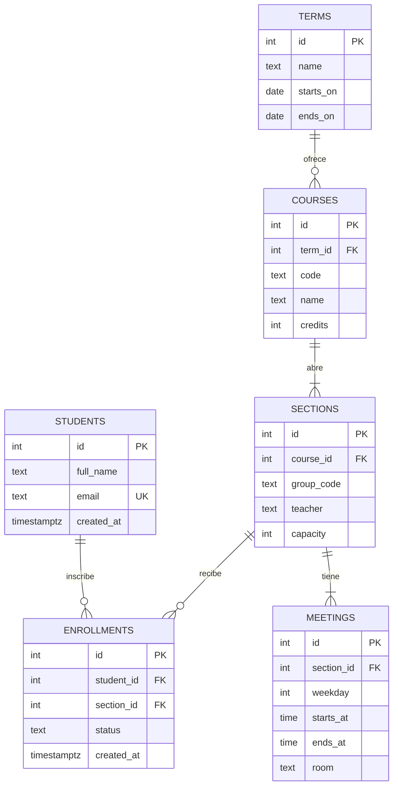

# PRD · Planificador de Horario Académico

> Documento de requisitos del producto (Product Requirements Document).
> Borrador del Sprint 0 (historia H0.3). Cada requisito funcional (RF) se convierte en un Issue
> con la plantilla "Historia de usuario".

| Campo | Valor |
| --- | --- |
| Alumno | Heyder (heyder2005) |
| Proyecto n.º | _(completar con el número asignado)_ |
| Sitio de referencia | _(se define en el Sprint 1, H1.1)_ |
| Compañero revisor | _(completar con el usuario de GitHub del revisor)_ |
| URL desplegada | (se completa en el Sprint 5) |

## 1. Problema

Cada semestre el estudiante universitario arma su horario a mano: copia la oferta de materias en
Excel o en papel, cruza franjas y descubre los choques el día de la inscripción, cuando ya no hay
cupos. El resultado es un horario con huecos, materias perdidas y decisiones tomadas con prisa.
No existe una herramienta que le muestre, antes de inscribirse, todas las combinaciones que caben
en su semana sin choques.

## 2. Usuarios

- **Usuario principal:** estudiante de pregrado (5.º semestre en adelante). Necesita ver la oferta
  de su programa, probar combinaciones y confirmar que no hay choques. Entra desde el celular el
  día de la inscripción y desde el portátil cuando planea con calma.
- **Usuario secundario:** monitor o consejero académico, que revisa cupos y detecta grupos
  saturados para recomendar alternativas.

## 3. Objetivo y métrica de éxito

«Un estudiante arma un horario sin choques y ve al menos 3 combinaciones válidas en menos de
3 minutos, desde el celular.»

## 4. Alcance del MVP

1. Catálogo de materias, grupos y franjas horarias.
2. Inscripción y retiro de grupos en el horario personal.
3. Detección automática de choques de horario.
4. Generación de combinaciones válidas de inscripción.
5. Vista semanal del horario.
6. Búsqueda y filtros por materia, docente y franja.
7. Importar y exportar el horario en CSV.
8. Deshacer y rehacer cambios en el horario.

### Funcionalidades → carpetas de `src/` (screaming architecture)

| Funcionalidad | Carpeta |
| --- | --- |
| Catálogo de materias y grupos | `src/courses` |
| Inscripción y retiro de grupos | `src/enrollments` |
| Detección de choques de horario | `src/conflicts` |
| Generación de combinaciones | `src/plans` |
| Vista semanal y agenda | `src/schedules` |
| Importar y exportar CSV | `src/imports` |

## 5. Fuera de alcance

- Inicio de sesión con el SSO institucional.
- Integración en vivo con el sistema de registro de la universidad (la oferta se carga a mano o por CSV).
- Notificaciones push o por correo.
- Aplicación móvil nativa.
- Pagos o matrícula.

## 6. Requisitos funcionales

| ID | Requisito | Prioridad |
| --- | --- | --- |
| RF-01 | Registrar materias con código, nombre y créditos por periodo académico | alta |
| RF-02 | Registrar grupos de una materia con docente, cupo y franjas horarias | alta |
| RF-03 | Inscribir y retirar grupos del horario del estudiante | alta |
| RF-04 | Marcar un choque cuando dos grupos se solapan en día y hora | alta |
| RF-05 | Generar combinaciones de grupos sin choques para una lista de materias | alta |
| RF-06 | Mostrar el horario en una rejilla semanal | alta |
| RF-07 | Filtrar grupos por materia, docente y franja | media |
| RF-08 | Importar y exportar el horario en CSV | media |
| RF-09 | Deshacer y rehacer el último cambio del horario | baja |

## 7. Requisitos no funcionales

- Responsive, móvil primero (375 px y 1280 px).
- Lighthouse ≥ 90 en Accesibilidad y Buenas prácticas.
- 0 errores en la consola del navegador.
- Funciona con 10.000 registros sin congelarse.
- La generación de combinaciones responde en menos de 100 ms con 10.000 grupos.

## 8. Modelo de datos

Seis tablas. `enrollments` resuelve la relación muchos a muchos entre estudiantes y grupos.

Restricciones principales:

- `courses (term_id, code)` único; `sections (course_id, group_code)` único.
- `enrollments (student_id, section_id)` único.
- `meetings.weekday` entre 1 y 7 y `meetings.ends_at > meetings.starts_at`.
- Borrado en cascada de `courses → sections → meetings`.

## 9. Reto técnico distintivo

_(Pendiente: confirmar con el catálogo del curso cuál es el reto asignado y describir aquí cómo se
va a resolver.)_

## 10. Riesgos y preguntas abiertas

- **Carga de la oferta:** no hay API pública de la universidad, así que el catálogo se llena a mano
  o importando CSV. ¿Cuántas materias y grupos entran en la semilla?
- **Explosión combinatoria:** con muchas materias, el número de combinaciones crece muy rápido.
  Hay que podar por choques antes de expandir y limitar el resultado.
- **Zona horaria y días:** definir si se guarda hora local del campus o UTC, y cómo se representan
  los días de la semana.
- **Datos personales:** el correo del estudiante es dato personal; definir si se anonimiza en las
  semillas y en el export.
- **Pendiente de completar en este borrador:** número de proyecto, compañero revisor y sitio de
  referencia.
